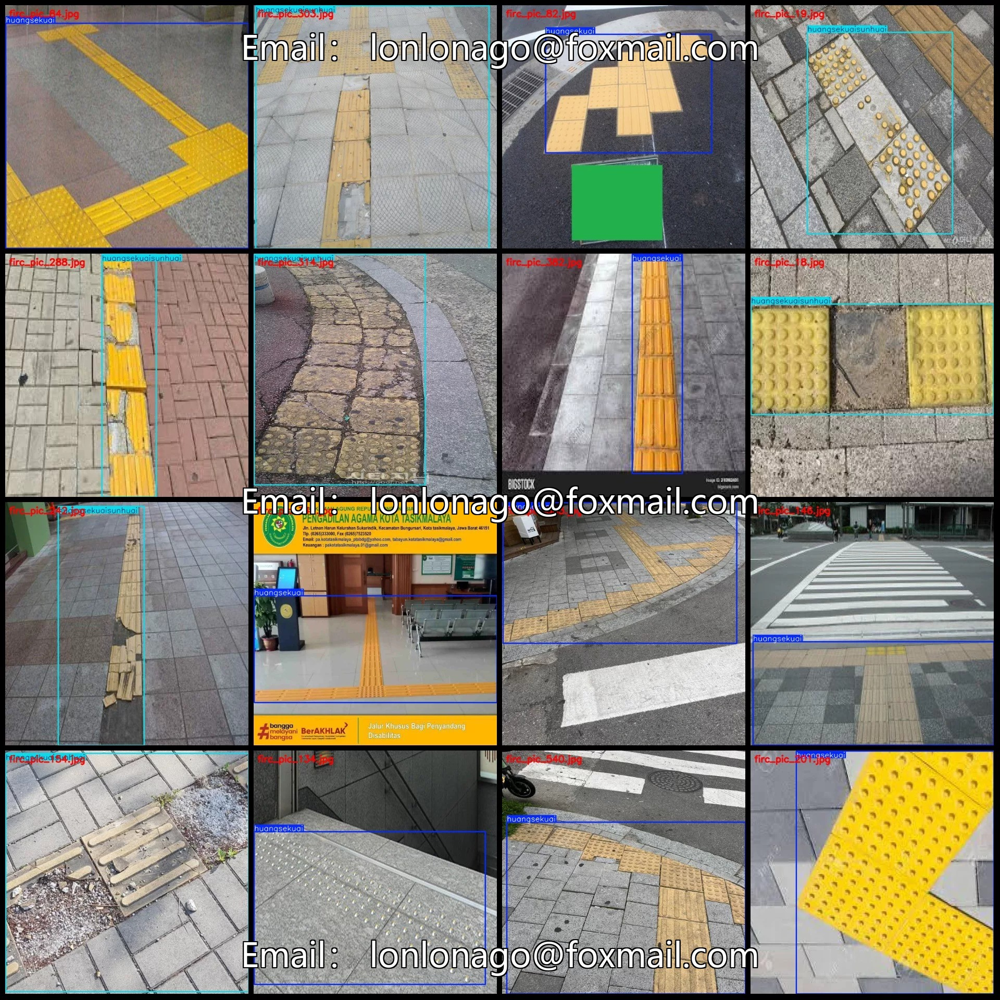
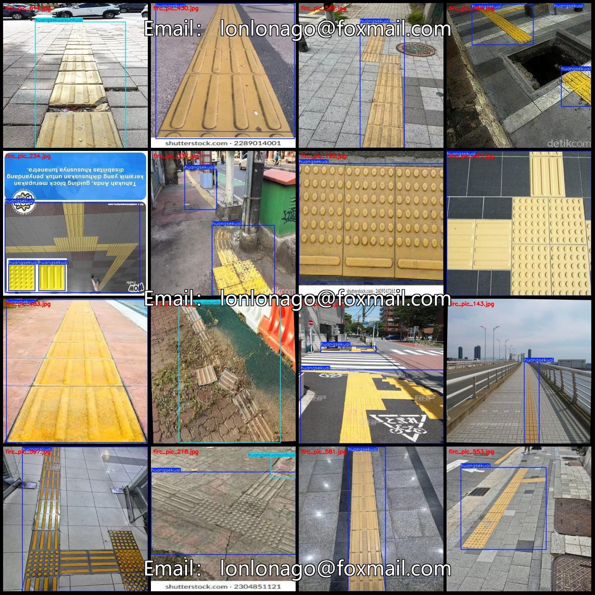
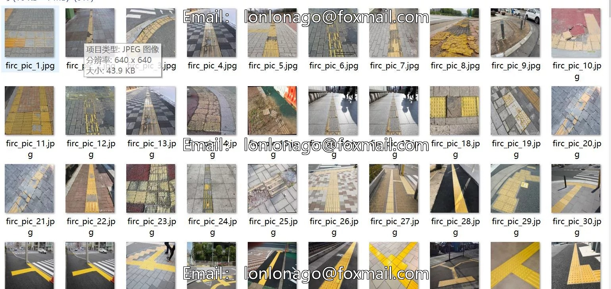
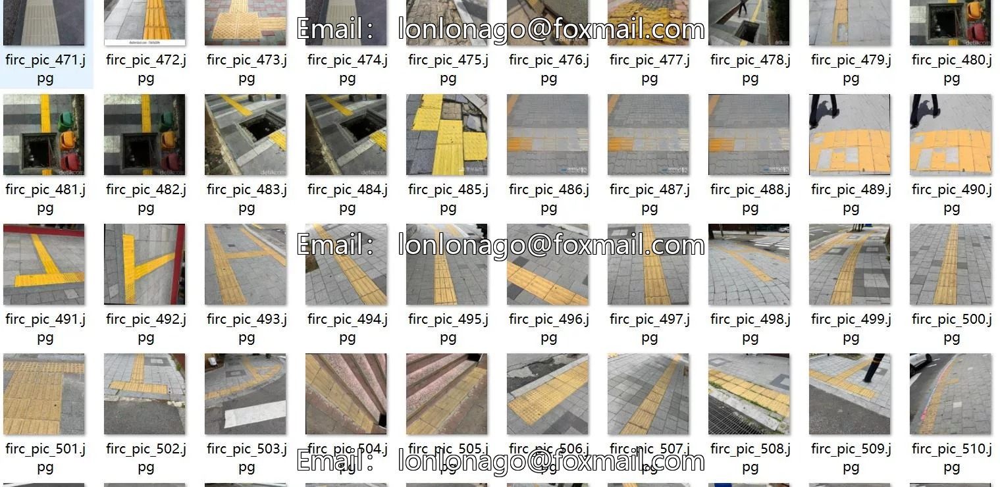
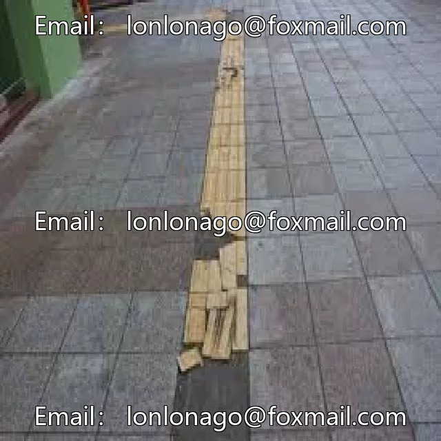
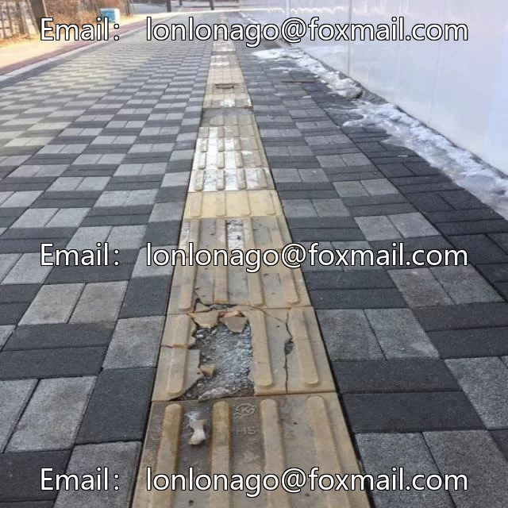
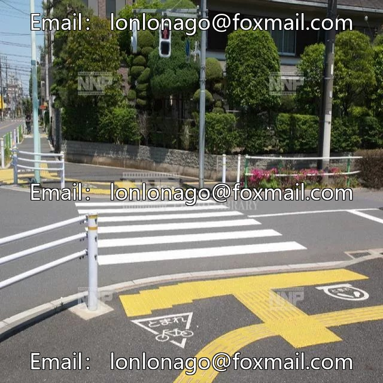

# Blind Path Damage and Damage Detection Dataset VOC+YOLO format with 617 images in 2 categories

## Body

Blind Path Damage and Damage Detection Dataset VOC+YOLO format: 617 images in 2 categories
Tips: Due to the dataset's replicability, please confirm compliance with requirements before purchasing.
Note: Some of the enhanced images are included in the dataset, please refer to the images for details.
Dataset format: Pascal VOC format + YOLO format (txt file without segmentation paths, only containing jpg images and corresponding VOC format xml files and yolo format txt files)
Number of images (number of jpg files): 617
Number of annotations (number of xml files): 617
Number of annotations (number of txt files): 617
Number of annotation categories: 2

Label category names (Note that the order of categories in the YOLO format does not correspond to this, but is based on the labels folder's classes.txt): ["huangsekuai", "huangsekuaisunhuai"]
Corresponding Chinese category name: ["yellow block", "yellow block damage"]
Number of boxes labeled in each category
huangsekuai frame count = 517
huangsekuaisunhuai Frame Count = 180
Total frames: 697
Number of images per category
Huangsekuai owns 454 images.
Huangsekuaisunhuai occupies the number of images = 173

Image resolution: 640x640
Using labeling tool: labelImg
Labeling rules: Draw a rectangle around the category.
Important note: The dataset does not have separate training, validation, and test sets; you need to partition them yourself.
Special declaration: This dataset does not guarantee the accuracy of the trained models or weight files.

## Images

## Payment

Here is a pay link on Stripe ( https://buy.stripe.com/3cs8yP7sY87d0vu9AB ). Please contact me lonlonago@foxmail.com after funding $89, and I will send you a complete data files , thank you!

